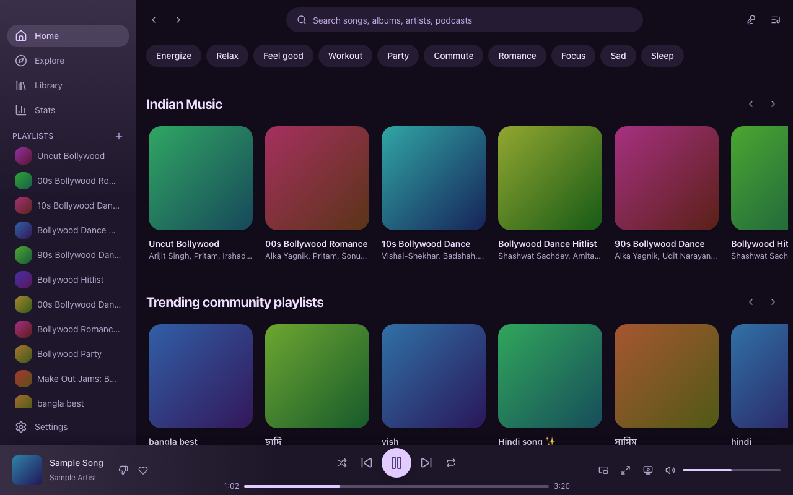
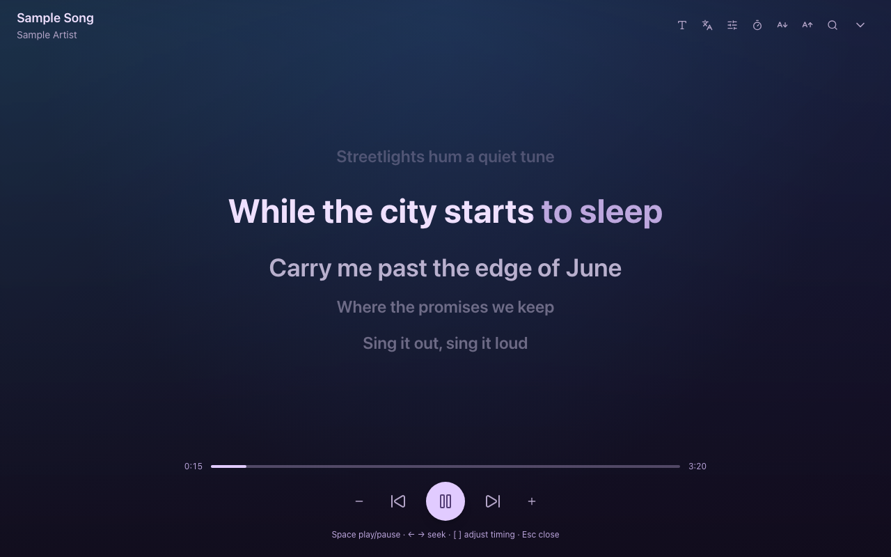
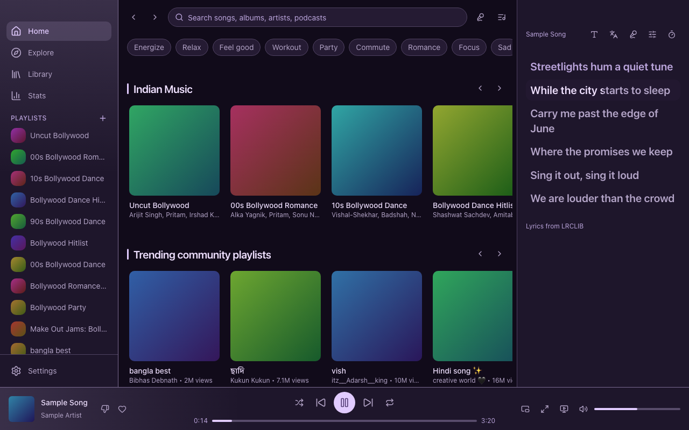
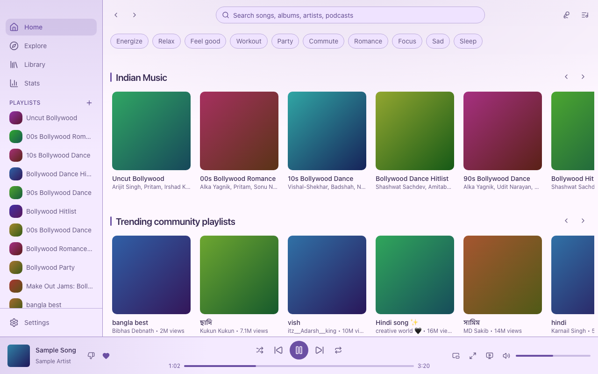

# Melodesk

**An open-source, native desktop client for YouTube Music on macOS and Windows (Linux as a bonus).**

> Melodesk is an independent open-source project. It is **not affiliated with, endorsed by, or
> sponsored by Google LLC or YouTube.** YouTube and YouTube Music are trademarks of Google LLC.
> Melodesk does not download media, block ads, or bypass any YouTube protections.

> Status: pre-alpha. The architecture is proven (our own UI drives the official web player);
> feature parity is in progress. See [docs/roadmap.md](docs/roadmap.md).

<p align="center">
  
  
</p>
<p align="center">
  
  
</p>

<sub>Screenshots are generated by `pnpm screenshots` from test fixtures: every cover is a generated
gradient and the lyrics are invented.</sub>

## Why

YouTube Music has no official desktop app. The usual options are a browser tab or a heavy
Electron wrapper. Melodesk is a small Tauri app that uses the OS's own webview, feels native
on each platform, and adds the power-user features a web player can't: a mini player,
global shortcuts, scrobbling, listening stats, a command palette, themes, and plugins.

## How it works (and why that is legal-safe)

All playback, sign-in, and ads happen inside the **official music.youtube.com web player**,
running in a webview window. Melodesk injects a small, audited bridge script into that page
that exposes a typed play/pause/seek/queue API to our own UI over Tauri IPC. Nothing about
your Google account passes through Melodesk's code: cookies live in the webview's own
encrypted storage, and sign-in is Google's own page.

See [docs/architecture.md](docs/architecture.md) for the full picture and the trust model.

## Features

Planned and in progress; ticked items work today.

- [x] Google sign-in through Google's own page (never through our code)
- [x] Play / pause / next / previous / seek / volume / shuffle / repeat from our own UI
- [x] Health check that shows "an update is needed" when YouTube changes something
- [x] Your own Home feed (same shelves, same order, infinite scroll), Explore, Charts, Moods & Genres, New releases
- [x] Search with live suggestions and YouTube's filter chips
- [x] Artist, album and playlist pages; context menus with YouTube's own actions
- [x] Library (playlists, songs, albums, artists, subscriptions, podcasts, uploads, history)
- [x] Live queue panel with drag-and-drop reorder, play next, add to queue
- [x] Create / rename / delete playlists, add-to-playlist dialog, lyrics panel (timed lyrics via the opt-in LRCLIB plugin)
- [x] Now Playing / media keys (macOS, Windows via the webview), MPRIS (Linux), tray with controls
- [x] Close to tray, launch at login, configurable global shortcuts, track-change notifications
- [x] `melodesk://` deep links and music.youtube.com link handling, signed auto-updates
- [x] Full-screen Now Playing with synced lyrics
- [x] Karaoke mode: big sing-along lyrics, words fill in time, countdown through instrumental breaks, timing nudge
- [x] Cover art kept for offline use (capped at 100 MB, clearable in Settings)
- [ ] Mini player (built, not yet checked on screen)
- [ ] Last.fm / ListenBrainz scrobbling, Discord Rich Presence (built as opt-in plugins, not yet checked against real accounts)
- [x] Light / dark / AMOLED themes, accent colors (including from album art), density, right-to-left layout
- [x] Translation framework with English strings; see [docs/translating.md](docs/translating.md)
- [x] Listening stats, command palette, plugins, lyrics romanization and translation

## What it can't do, and why

We would rather say so than ship something that breaks playback.

- **Equalizer and volume normalization.** They need Web Audio on the player's media element, and
  WebKit (macOS, Linux) hands that route silence for YouTube's streams. Measured on macOS. The engine
  is in place and refuses to touch playback there; Windows (Chromium) is untested. Details in
  [docs/architecture.md](docs/architecture.md).
- **Crossfade.** The page owns the one player; there is nothing to fade into.
- **Removing vocals from a song.** That means processing or extracting the audio, which Melodesk
  never does. Karaoke mode shows the lyrics and can search for an existing karaoke version.

## Install

Pre-built installers will be published on the Releases page once Phase 1 is complete.

## Build from source

Requirements: Node 22+, pnpm 10, Rust 1.85+ (a `rust-toolchain.toml` pins the exact version),
and the [Tauri prerequisites](https://v2.tauri.app/start/prerequisites/) for your OS.

```bash
pnpm install
pnpm dev
```

```bash
pnpm build
```

Useful scripts: `pnpm test`, `pnpm test:e2e`, `pnpm typecheck`, `pnpm lint`, `pnpm clippy`,
`pnpm screenshots`. End-to-end tests run the real UI in headless Chromium against a mocked Tauri
backend; the first time, run `pnpm --filter @melodesk/desktop exec playwright install chromium`.

## Privacy

No telemetry. Nothing leaves your machine except the traffic the YouTube Music web app itself
generates. Optional integrations (scrobbling, Discord) are off by default and documented.

## FAQ

**Is this against YouTube's terms?** Melodesk is a browser-like shell around the official web
player with a UI on top. It does not extract streams, download media, or block ads. We think
that is the right side of the line, but we are not lawyers and this is not legal advice.

**Does it need YouTube Music Premium?** No more than the website does. Ads play if you don't
have Premium; background playback works because the player runs in an app window.

**Why Tauri and not Electron?** Smaller installer, less memory, and native webviews.

## Contributing

See [CONTRIBUTING.md](CONTRIBUTING.md). Good first issues are labelled on the issue tracker; a
starting list with pointers into the code is in [docs/good-first-issues.md](docs/good-first-issues.md).

## License

[MIT](LICENSE)
